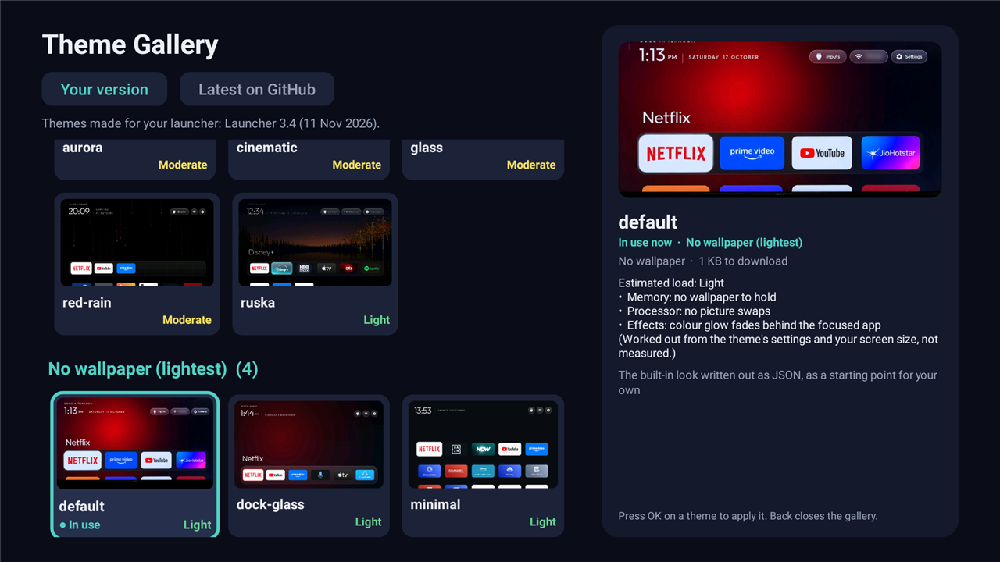

# CleanYourTV Theme Gallery

> **Unofficial community app.** Not affiliated with or endorsed by the
> [cleanyourtv](https://github.com/Gathin23/cleanyourtv) project. It works alongside that project's
> launcher; it is not part of it.

A small Android TV app that lets you **browse and switch the themes** of the
[cleanyourtv](https://github.com/Gathin23/cleanyourtv) launcher (`com.gathin.tvhome`) **from the TV
itself**, with the remote — instead of pushing each theme from a computer.

It reads the themes straight from the cleanyourtv GitHub repository, sorts them into categories, shows
a screenshot, description and an estimated memory/CPU load for each, and applies the one you pick. The
old theme is replaced, not kept.

The cleanyourtv launcher stays fully offline (no internet permission); this gallery is the only piece
that goes online, and only while it is open.



Tested on a Philips 43PUS7906/12, Android TV 11.

## What it does

- **Two tabs:** *Your version* (the themes made for the launcher build you have) and *Latest on GitHub*
  (the newest themes, with ones that aren't in your version marked **NEW**).
- **Categories, worked out automatically** from each theme's own settings: rotating wallpapers,
  changes with the time of day, one fixed wallpaper, no wallpaper, and festival themes.
- **Details panel:** a large screenshot, the description from the themes README, the number of
  wallpapers and how often they change, the download size, and an **estimated load** (Light / Moderate /
  Heavier) worked out from the theme's settings and your screen size. It is an estimate, not a
  measurement.
- **Applying** downloads everything first, then replaces the theme through the launcher and returns to
  Home. It also carries over the settings you added for your own apps rather than the look: apps you
  added to Home (`library_apps`) and a tile's picture, name and where it opens (`app_banners`,
  `app_labels`, `launch_actions`), so a custom tile such as a Live TV shortcut survives a theme change.
- **Privacy:** it contacts only GitHub (`raw.githubusercontent.com` / the repo tree API), only while
  open. No account, no tracking, no background service.

## Requirements

- An Android TV / Google TV running the **cleanyourtv launcher** (`com.gathin.tvhome`).
- **After applying a theme, restart the TV** (or the launcher) to see it in full. The official launcher
  only fully loads a theme when it starts, and Android doesn't let another app restart the Home app.
  If you build the launcher yourself, the small optional patch below makes Home switch to the new
  theme straight away, with no restart.

## Get the app

**Download** the APK from [Releases](https://github.com/CARRisma1978/cleanyourtv-theme-gallery/releases),
or **build** it: JDK 17 and Android SDK platform 34 + build-tools 34, then from this folder:

```
./gradlew assembleRelease
```

The APK (about 38 KB) is at `app/build/outputs/apk/release/app-release.apk`. It is signed with the debug
key (sideloaded over ADB, not published to a store).

**The *Your version* tab** shows the themes from one specific cleanyourtv commit, set in
[`app/build.gradle`](app/build.gradle) (`installedRef` / `installedLabel`). It is pinned to the build this
app was tested with; if you build the app, change it to the commit your own launcher was built from,
otherwise *Your version* and the **NEW** badges won't match your launcher.

## Install and grant the one-time permission

The launcher only accepts themes from an app holding `WRITE_SECURE_SETTINGS`, which cannot be granted
from the TV — it is granted once over ADB and then persists:

```
adb install -r cleanyourtv-theme-gallery-1.1.apk
adb shell pm grant uk.home.themegallery android.permission.WRITE_SECURE_SETTINGS
```

Then open **Theme Gallery** from the TV's apps, pick a theme and press OK.

## Optional: instant theme switching (launcher patch)

[`launcher-patch/launcher-reload.patch`](launcher-patch/launcher-reload.patch) is a small change (22 added
lines in `MainActivity.java`) for people who build the cleanyourtv launcher themselves. Home remembers the
size and time of its theme files, and when it comes back to the front and they have changed, it rebuilds
itself — the same way it already reacts to a change in Launcher settings. With it, a theme applied from the
gallery appears as soon as you're back on Home.

From a checkout of [cleanyourtv](https://github.com/Gathin23/cleanyourtv):

```
git apply path/to/launcher-reload.patch
```

then build and install the launcher as that project describes. Checked against cleanyourtv `main` of
22 Nov 2026 (`fe6cdce`): applies cleanly and builds. It is a local modification of someone else's
project, so a future launcher update may need it re-applied or adjusted.

## How applying a theme works

The launcher exposes a `ThemeProvider` content provider (authority `com.gathin.tvhome.theme`) that only
accepts callers holding `WRITE_SECURE_SETTINGS`. The gallery downloads the chosen theme's `config.json`,
`wallpaper.jpg` and wallpaper collection from GitHub, writes them through that provider, clears the old
theme's files, and updates the launcher's theme-revision marker. The new theme shows in full after the
launcher restarts, or straight away with the patch above.

## Licence

MIT — see [LICENSE](LICENSE). Themes, their screenshots and descriptions belong to the
[cleanyourtv](https://github.com/Gathin23/cleanyourtv) project and its contributors.
